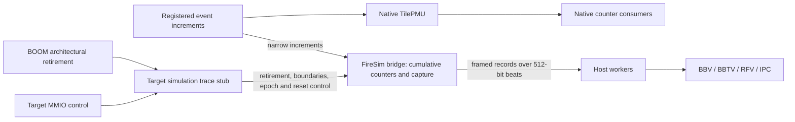

# BOOM PMU and simulation tracer plan

Date: 2026-09-21\
Status: standalone native PMU and compiler-check prototype implemented ([code](../generators/pmu/README.md)); the BOOM v3 native counter catalog is integrated; the simulation tracer remains planned.\
PMU module name: `TilePMU`.
Working trace names: `SimTraceStub` / `SimTraceBridge` (names are provisional).
Initial event selection: [native PMU counter catalog](boom-pmu-counter-catalog.md)
(19 native counters; proposed bridge payload uses uniform 64-bit values).
Packet format and arbitration: [BB/PMU packet plan](firesim-bb-pmu-packet-plan.md).

## Objective

Build a measurement path for full-run FireSim experiments that produces BBV,
BBTV, RFV, and IPC observations over common, dynamically block-aligned
instruction intervals. Use it to reproduce the methodology of Magnus Ekman's
*CPU Simulation Using Two-Phase Stratified Sampling* and evaluate BBTV as an
alternative to BBV and baseline-derived RFV for selecting representative regions.

BBTV deliberately captures the baseline microarchitecture's timing response.
Like RFV, it can distinguish executions of the same code with different dynamic
behavior. The research question is whether attaching timing to block identity
improves region selection and transfer across processor configurations. This is
not a claim that BBTV is microarchitecture-independent.

FireSim full executions provide a reference for the modeled machine and captured
execution. Reproducing the method on BOOM/RISC-V does not imply reproducing the
paper's exact ARMv9 error percentages.

## Agreed architecture



Placement is decided: native cumulative counters remain in TilePMU, the target
stub supplies instruction-boundary/control signals, and independent uniform
64-bit cumulative counter state lives in the bridge. The host computes deltas. The [PMU API v1](boom-pmu-api.md) defines registration,
clock/reset rules, and the registry-to-annotation-to-bridge-catalog handoff.

### DUT: TilePMU and simulation trace stub

- `TilePMU` accumulates registered performance-event increments with documented
  semantics. All accumulators share one configured width, initially 64 bits.
  It exposes enable, clear, live values, and coherent native snapshots through
  the [MMIO interface](boom-pmu-mmio.md). It does not compute trace deltas or own
  trace interval tags. Native controls do not gate registered bridge increments.
- The stub observes architectural retirement, tracks instruction counts and
  dynamic block boundaries, and fires interval triggers.
- Target software configures and arms the capture. Hardware handles recurring
  intervals without software intervention.
- A trace attachment identifies registered increment wires and the stub's
  boundary/control signals for compiler routing to FireSim channels. Native
  full-width counter values do not need to cross that interface.
- The compiler passes the validated increment catalog into bridge Chisel. The
  bridge builds uniform 64-bit cumulative counters and captures them at target
  boundaries. PMU packets span as many 512-bit beats as necessary; the host
  computes deltas. Range-derived compact fields are deferred.
- Keep this implementation separate from the existing oracle's ROB-state trace
  generation. Core changes should principally expose observations and connect
  modules, rather than embed another tracer in `core.scala`.

### FireSim bridge: interval accumulation, capture, and reliable transport

- Accept narrow per-cycle increments, retirement observations, interval markers,
  and aligned reset/epoch control. Advance observation state only on acceptance
  of a target-cycle token. Capture cumulative values including that token's
  increments when its target boundary marker requests it; do not clear on each
  boundary.
- Use a dedicated bridge and driver on FireSim's shared `StreamToHostCPU`
  transport. Pad each BB record to one beat and each PMU record to a whole
  number of beats. Complete wide PMU packets use a continuously valid
  wide-to-512 serializer; an ordinary beat-priority arbiter selects PMU before BB. No TraceDoctor producer,
  protocol, or worker is required.
- Preserve BB retirement order and associate PMU packets using explicit
  snapshot/retirement endpoints. A PMU packet can precede its closing BB; its
  arrival is not an implicit interval delimiter. Atomic target-cycle capture,
  not priority, defines the measurement time.
- When transport cannot accept more work, pause target-token acceptance while
  continuing bridge serialization/draining on host cycles.
- Never turn host congestion into extra BOOM retirement-stall cycles. Finite
  buffers are acceptable because simulation backpressure provides losslessness.

The [transport reassessment](firesim-pmu-stream-transport.md) supersedes the
previous mandatory one-beat constraint. PrintBridge already serializes wide
records, and Cospike/TracerV emit multiple beats per target observation. The
shared stream engine supplies bulk transport, including XDMA on supported
platforms. The new bridge owns framing and serialization; physical routing and
storage costs still require measurement.

### Host workers: accounting and analysis

- Reconstruct dynamic blocks and assign stable block IDs.
- Build interval BBVs and BBTVs, derive RFVs from software counter deltas, and compute
  IPC/CPI using actual instruction and cycle counts.
- Retain raw counts and interval metadata alongside derived features.
- Implement an independent stream decoder and workers with record reassembly
  across DMA pulls. TraceDoctor's worker/buffering approach is an optional
  reference, not a dependency or mandatory interface.

## Existing implementation and reuse boundaries

The current TraceDoctor oracle packs a 512-bit token in BOOM, then forwards it
through a payload-agnostic FireSim bridge. It exports architectural commits and
ROB-related state events. Its host workers implement computing/stalled/flushed/
drained accounting, including backward attribution of some recovery periods.

That path remains useful as a comparison instrument. It is not the new stub's
required protocol. A retirement-only knob for the old producer is optional
experimental support, not a prerequisite for this architecture. Existing
four-state workers require the original state observations.

`LazyTraceEncoder` and `LazyTraceSink` provide useful module construction and
attachment patterns. Reuse is conditional:

- Their current `TraceEgressInterface` carries four bytes per target cycle;
  do not force the new observation path through it.
- The encoder's `perf` interface reports tracer pressure/drops, not CPU events.
- Encoder `stall` currently feeds BOOM's architectural retirement stall. The
  simulation-only measurement path must not inherit that behavior.
- The current ingress includes some exception notifications in its valid count.
  The new stub must receive an explicit architectural-retirement mask.

The existing architectural PMU foundation includes HPM event selectors, counters,
counter inhibition, and access controls in Rocket's CSR implementation. BOOM's
event definitions are sparse and embedded in the core. The new PMU API accepts
one producer-computed increment wire per counter; all reductions belong to the
producer. Existing CSR ownership remains separate, with any compatibility
adapter treated as follow-on work.

## Interval contract: NEMU-compatible dynamic blocks and overshoot

### Dynamic block definition

Use executed control flow, following NEMU's optimized SimPoint profiling path:

- Direct/indirect jumps and conditional branches terminate a block.
- Both taken and not-taken conditional branches terminate a block.
- Identify a block by `(start_pc, terminating_pc)` within the relevant code and
  address-space identity. No static CFG is required for this partition.
- The first instruction executed after a terminator starts the next block.
- Derive executed instruction counts from cumulative retirement counts, not
  address subtraction: RISC-V instructions can have different lengths.

Trap transitions, capture start/end, and context changes require explicit
handling of partial blocks. These are extensions to be specified and tested;
do not assume NEMU's privileged paths are all equivalent to ordinary branches.

### Trigger arithmetic

Let `L` be the nominal interval size, `count` the instructions in the current
actual interval, and `drift` the overshoot retained from previous intervals.
Initially `count = drift = 0`.

Process architectural retirements in program order. At each completed block:

```text
count has included all instructions through this block's terminator
if count + drift >= L:
    close the actual interval, including the whole completed block
    drift = count + drift - L
    count = 0
```

Only the threshold adjustment carries forward. All instructions of the closing
block remain in the closing interval's BBV/BBTV. They are neither split across
intervals nor counted again in the next interval.

Example, `L = 1000`:

| Interval | Actual instructions | Incoming drift | Outgoing drift | Cumulative end |
| --- | ---: | ---: | ---: | ---: |
| 0 | 1007 | 0 | 7 | 1007 |
| 1 | 998 | 7 | 5 | 2005 |
| 2 | 995 | 5 | 0 | 3000 |

After emitting `m` intervals, the invariant is:

```text
total retired instructions included in emitted intervals = m * L + drift
```

This preserves the nominal grid without accumulated boundary drift. Do not
restart the next threshold at `actual_end + L`.

NEMU performs one `if` per completed block, not a `while`. A block spanning
multiple nominal intervals emits one interval and retains the remaining debt.
Later blocks can then produce short intervals until the debt is paid down.
Preserve this behavior for compatibility; do not skip interval IDs or emit
empty intervals at the same block boundary.

### Superscalar extension

- Evaluate boundary eligibility using a prefix count through each retiring
  slot. Testing only the final group count could incorrectly close at a branch
  that retired before the threshold was crossed.
- A branch can close an interval before younger instructions in the same group.
  Those younger instructions belong to the next interval.
- Record the boundary's retirement index and slot position.
- With large retained drift and multiple branches in a group, more than one
  logical interval can close in one cycle. The structured interface must support
  this or explicitly flag the case as unsupported. Do not silently merge it.
- Interval debt and cumulative counters must not truncate on large blocks.

### Start, stop, and partial intervals

Proposed initial behavior:

- Capture has an explicit origin and emits a baseline cumulative PMU snapshot
  with timestamp/retirement metadata. The host uses it for subsequent deltas;
  reset or a new epoch starts a new baseline.
- A start inside a dynamic block creates a flagged partial block.
- Stop emits a final marker and snapshot, retaining a flagged partial interval
  for accounting. The SimPoint-compatible export omits the partial tail by
  default, matching NEMU's lack of destructor-time partial BBV emission.
- Configuration changes apply only while disarmed or begin a new capture epoch.
- Session/epoch IDs prevent counter resets or restarts from being interpreted as
  ordinary interval deltas.

The exact start/stop edge relative to MMIO acceptance and retirement remains a
pre-implementation decision. Target MMIO timing is acceptable; it must be
observable and documented, not mistaken for retirement of the configuring store.

## Timing and PMU snapshot semantics

### Separate instruction boundaries from cycle boundaries

A logical block boundary may occur inside a commit group. A PMU snapshot observes
whole target cycles; it cannot separate events between retirement slots.

Recommended initial convention, still to ratify:

- The logical instruction boundary ends at the selected branch slot.
- The PMU snapshot includes all selected events through that target cycle.
- Whole-cycle timing assigns the boundary cycle to the closing interval.
- Export both logical instruction position and physical snapshot cycle, plus
  the complete group's retirement count.

Younger instructions can therefore belong to the next logical interval while
sharing a cycle charged to the closing interval. This is an explicit accounting
convention, not causal ownership of every PMU event. Speculative events are not
in general attributable to the instructions retiring during the same period.

If several logical boundaries occur in one cycle, they can reference one
physical counter observation; its delta must not be added multiple times.
Zero-cycle intervals must be flagged; do not generate infinite IPC or silently
change the block partition. The export policy for these pathological intervals
is an open decision.

### Snapshot implementation

- Align increment, retirement, timestamp, and boundary/control observations for
  the same target cycle. Update bridge state only on accepted target tokens.
- Capture the cumulative sum including the current token's increments, then
  retain the entire coherent vector until its packet has been emitted. Do not
  clear running counters at each boundary or read live counters word by word.
- Use 64-bit modulo counters and host subtraction within one epoch. The former
  range-sized saturating-delta format is deferred; all ones is an ordinary
  counter value, not a sentinel in this format.
- Native MMIO counter controls do not change bridge accumulation. Reset/rearm
  and capture-window semantics are explicit and establish new baselines.
- Pad BBs to one beat; statically pad complete PMU packets to a beat boundary.
  Serialize the retained wide packet with valid continuously asserted until its
  final beat transfers. Ordinary PMU beat priority then guarantees contiguity.
  Hold any selected stalled output beat stable.
- Use the bounded per-target-cycle batch scheduler and endpoint-based host
  association in the [packet plan](firesim-bb-pmu-packet-plan.md). Priority alone
  neither prevents starvation with arbitrary future traffic nor establishes
  chronological BB/PMU association.

Initially support core-clock observations. Uncore/multiclock RFV events need a
separate alignment contract before inclusion; a synchronized pulse alone does
not establish simultaneous snapshots across clock domains.

## BOOM PMU work

Detailed follow-up: [PMU registration and elaboration plan](boom-pmu-registration-plan.md).

Create one documented event catalog with semantic names, increment widths,
units, source stages, and availability metadata. Assign dense IDs at finalization
and emit a companion JSON mapping; captures identify the applicable manifest.
Each counter receives one explicit increment wire with any reduction already
computed by its producer. The research path consumes this interface directly;
a later architectural HPM adapter may reuse definitions without imposing legacy
selector or reduction rules on the PMU API.

Initial candidate families:

| Family | Candidate events | Definition work |
| --- | --- | --- |
| Execution | Actual retirements, retired control flow, cycles | Count instructions rather than valid exception records; define cycle scope |
| Prediction | Resolutions, resolution mispredictions, retired mispredicted branches | Keep speculative/resolution and retirement meanings distinct |
| Frontend | Fetch starvation, I-cache events, ITLB misses | Separate transactions from cycles waiting |
| Memory | Loads/stores, D-cache acquisitions/releases, DTLB events | Separate requests, accepted requests, misses, retries, refills |
| Resource pressure | ROB, issue, load/store queue pressure | Define occupancy, full cycles, and blocked work separately |
| Stalls | Selected frontend/backend conditions | Document overlap; do not call arbitrary overlapping conditions a CPI decomposition |

Audit the underlying signals before assigning familiar names. For example,
BOOM currently labels `io.lsu.perf.acquire` as a D-cache miss event; its exact
transaction semantics need verification.

Support increments greater than one where multiplicity matters. An unavailable
event must be represented as unavailable, not a zero measurement. Do not claim
the paper's full RFV is reproduced until every included metric has a documented
mapping; its detailed stall bins and cache hierarchy may not map directly to BOOM.

Overflow interrupts, complete OS `perf` integration, and broader architectural
PMU extensions are later scope. They are not prerequisites for the measurement
event interface and interval snapshots.

## Structured observation and transport contract

Proposed semantic fields, before assigning bit positions:

- Schema version, hart/source ID, capture epoch, event-catalog identity.
- Target-cycle timestamp and cumulative architectural retirement count.
- Ordered retirement validity and control-flow metadata, instruction sizes,
  context/privilege, and enough successor information to reconstruct indirect
  destinations and trap edges.
- Interval markers: ID, actual retirement position, boundary slot, nominal
  threshold/debt metadata, and partial/exceptional-boundary flags.
- BB packet: 64-bit header plus start/end PCs, cumulative retirement endpoint,
  and cycle timestamp, all 64-bit, then three padding words.
- PMU packet: one 64-bit header, snapshot ID, logical retirement boundary,
  physical cycle timestamp, full-cycle retirement endpoint, and uniform 64-bit
  counters in manifest order; pad the last beat. See the packet plan for the
  proposed header and metadata allocation.

Target observations and RFV snapshots occurring in the same cycle must both
survive bridge backpressure. Use the FireSim channel contract explicitly; do not
assume an unacknowledged one-cycle pulse is safe across arbitrary buffering.

The bridge should first use a simple capture/serialize state machine that stops
accepting target tokens while required output records drain. This establishes
correctness with bounded storage. Overlap and double buffering are subsequent
throughput optimizations.

All target-observation bookkeeping in the bridge advances only on target-token
acceptance. Host-side serialization advances on host-side handshakes. Paused
target time must not duplicate retirements, triggers, timestamps, or events.

Compute record size from header and payload fields, then derive its beat count
and final padding. A record may exceed 512 bits and is serialized in the bridge;
each BB is one beat, while a PMU packet can span several. Keep PMU beats
contiguous with continuous PMU validity and beat priority; reconstruct records
across DMA reads.
Counter values do not change record length. A stop must drain
complete records and the last DMA batch; detect incomplete captures explicitly.

### Trace detail and BBTV accounting

The required long-term information is control-flow retirement timing and actual
instruction counts. Full ordinary-instruction PCs are optional.

Before reducing the stream, choose the supported BBTV convention:

- Control-flow endpoint timestamp differences support a block-time accounting
  convention with inherited delay assigned to the following block.
- Reproducing the oracle's per-commit `1/n` computing-cycle splits requires
  additional commit-group observations. Sparse branch timestamps alone cannot
  recover those splits.
- Preserve enough group/boundary metadata for the selected convention. Keep an
  optional detailed retirement mode for diagnosis and attribution comparisons.

Do not promise that every accounting algorithm can be reconstructed from the
minimal stream. The primary BBTV policy and its treatment of shared boundary
cycles are open design decisions.

## Host outputs and numerical contract

For every actual interval, retain a manifest with capture/source identity,
instruction and cycle endpoints, block-boundary metadata, raw counter deltas,
and validity/partial flags.

- **BBV:** instruction contributions per dynamic block identity. Preserve raw
  counts and provide SimPoint-compatible sparse-vector output.
- **BBTV:** attributed time per the same block identities. Preserve total time;
  normalization to unit sum discards CPI magnitude. Store the attribution-policy
  identifier with the output.
- **RFV:** derive rates from software differences of cumulative snapshots with
  explicit denominators. Use only same-epoch endpoints. Fit feature scaling on
  characterization data and freeze it for evaluation.
- **IPC/CPI:** use actual instruction and cycle counts. Aggregate IPC as
  `sum(instructions) / sum(cycles)`, not an arithmetic mean of interval IPCs.
  Use logical instruction endpoints and actual timestamps for logical-interval
  IPC; whole-cycle PMU retirement totals can differ at a superscalar boundary.

Record actual interval instruction lengths for clustering/weights and replay.
Do not substitute the nominal million-instruction length after block alignment.
Preserve block ranges and binary identity rather than treating encounter-order
block IDs or an ASID alone as permanent identities across executions.

Proposed initial capture scope is a single hart with all execution inside the
armed ROI counted and context transitions recorded. Workload migration, per-task
event attribution, and user-only filtering need explicit later contracts.

## Implementation sequence and completion checks

### 1. Finalize interfaces and measurement semantics

- Resolve the open decisions below and document record semantics before bit
  packing.
- Define the observation bundles, PMU catalog metadata, MMIO control behavior,
  and expected host outputs.
- Write a small software interval reference implementing NEMU's carry rule.

Complete when hand-worked traces cover ordinary boundaries, overshoot, multiple
branches per group, and capture edges without ambiguous ownership.

### 2. Establish the BOOM PMU event interface

- Prove registry/routing and bridge observation through the actual Golden Gate
  flow. Verify domain/width validation, annotation/catalog serialization,
  cumulative bridge accumulation/capture, and multi-beat packet transport.
  Existing range-analysis experiments remain useful for optional compression.
- Factor/expose the selected BOOM event producers with one explicit increment
  wire per counter. Producers compute all ORs, sums, and other reductions.
- Add TilePMU accumulation/current-value/clear interfaces and integrate the
  trace observation logic with coherent cumulative snapshots.
- Start with a small validated event set; expand toward RFV coverage afterward.
- Treat architectural HPM compatibility as follow-on work through a separate
  adapter; it does not determine the registry or PMU accumulation API.

Complete when directed workloads reconcile retirement counts and selected event
counts, and simultaneous increments/snapshot/reset behavior is tested.

### 3. Implement the separate simulation trace stub

- Add configurable attachment and target control outside the oracle producer.
- Consume true architectural retirements; implement ordered block-boundary
  detection, count/debt arithmetic, epoch state, and PMU snapshot triggers.
- Export structured records and boundary metadata.

Complete when grouped retirement inputs produce the same logical intervals as
the serial software reference, including large debt and not-taken branches.

### 4. Implement the FireSim bridge and host decoder

- Accept aligned increment, retirement, and boundary/control channels; generate
  coherent cumulative snapshots inside the bridge.
- Serialize framed records over 512-bit beats and implement lossless simulation
  backpressure, with no TraceDoctor dependency.
- Add decoding/dispatch compatible with the host worker architecture.
- Validate end-of-run draining and format rejection.

Complete when randomized host stalls change wall-clock throughput but produce
identical decoded observations and target measurement results.

### 5. Implement the analysis workers

- Build block reconstruction, interval manifests, BBV, BBTV, RFV, and IPC outputs.
- Add explicit policies for partial and zero-cycle intervals.
- Compare detailed and compact trace modes where both support the same metric.

Complete when instruction totals and same-epoch software counter deltas
reconcile with reference totals, including PMU-before-BB packet order, and time
attribution reconciles under the chosen convention.

### 6. Integrate and evaluate

- Run directed BOOM metasim tests, then a small FPGA capture before full workloads.
- Compare against the existing oracle where semantics overlap. Differences in
  flush attribution are expected; unexplained missing work is not.
- Establish full-run timing references and measure instrumentation overhead.
- Only then expand PMU coverage and workload/configuration count.

Do not launch FPGA builds/jobs merely to write or review this plan. They become
part of the subsequent authorized implementation and validation work.

## Validation matrix

| Concern | Required case |
| --- | --- |
| Dynamic blocks | Taken/not-taken branches, direct/indirect jumps, mixed instruction lengths |
| Overshoot | Exact threshold, one-block overshoot, carried debt, block longer than multiple intervals |
| Superscalar retirement | Threshold before/at/after a branch slot; multiple branches and boundaries in one group |
| PMU observations | Inclusive cumulative capture, frozen vector, baseline/reset, software deltas, multiple boundaries per cycle |
| Packet layout | One padded BB beat; PMU metadata and 64-bit words, beat count, final padding, length validation |
| Capture lifecycle | Empty capture, partial first/last blocks, stop during a stall, rearm, reset |
| Context | Trap entry/return, nonretiring fault notification, ASID/privilege transition |
| Transport | Continuous PMU valid through all beats, stalled BB stability, bounded-batch priority, split DMA reads, final draining |
| Conservation | Every counted instruction exactly once; no duplicated events; time totals match the declared policy |

The existing TraceDoctor standalone suite passed 11 tests during repository
inspection. Its optional real-capture replay was skipped. That is background
evidence for existing code, not validation of this new design.

## Research experiment structure

- Characterize workloads with full FireSim executions where feasible, including
  per-interval timing and the agreed PMU event set.
- Compare BBV, BBTV, and baseline RFV using identical actual intervals and
  comparable region budgets. Separate representation effects from clustering
  and representative-selection effects.
- Recreate random and stratified sampling experiments from the full-run data;
  evaluate confidence-interval coverage as well as point-estimate error.
- Freeze characterization/scaling/selection choices before held-out processor
  configurations. Full executions on those configurations provide their own
  references.
- Measure absolute CPI error, speedup error, design-ranking errors, and
  collection/storage/FPGA costs. Report per-workload outliers.
- Treat deterministic representative selection separately from randomized
  sampling confidence intervals.
- Evaluate selection from continuous executions before adding checkpoint/restart
  experiments, so warm-up/restoration effects remain distinguishable.

## Decisions still open before RTL implementation

1. Primary BBTV timing policy and the minimum stream needed to reproduce it.
2. Final within-commit-group PMU/time boundary convention; treatment of several
   logical boundaries in one cycle.
3. Exact capture arm/start/stop edges and handling of partial blocks.
4. Initial event catalog and event/boundary signal latency. Native and bridge
   accumulation ownership follows PMU API v1.
5. Core-only first milestone versus any required uncore RFV events.
6. Concrete attachment/API names and how much of `LazyTraceEncoder` construction
   to reuse without inheriting its narrow transport or architectural stalls.

These do not require reconsidering the overall PMU + stub + bridge + worker
architecture. They define the semantics that implementation and tests must share.

## Source map

- [Ekman paper, local PDF](2603.22605.pdf), [arXiv source](https://arxiv.org/pdf/2603.22605).
- [NEMU SimPoint profiling](/home/ubuntu/work/NEMU/src/checkpoint/simpoint.cpp:106): dynamic block closure and overshoot carry.
- [NEMU execution hooks](/home/ubuntu/work/NEMU/src/cpu/cpu-exec.c:244): branch/jump boundaries, including not-taken branches.
- [NEMU block profiling hook](/home/ubuntu/work/NEMU/src/cpu/cpu-exec.c:342): terminating PC, next PC, cumulative count.
- [SimPoint 3.0 paper](https://cse.ucsd.edu/~calder/papers/MOBS-05-SimPoint3.pdf): interval drift and weighted metrics.
- [BOOM events](../generators/boom/src/main/scala/v3/exu/core.scala): `perfEvents`, retirement ingress, and oracle token producer.
- [BOOM tile attachment](../generators/boom/src/main/scala/v3/common/tile.scala): encoder/controller/sink wiring and architectural stall connection.
- [Trace interfaces](../generators/rocket-chip/src/main/scala/trace/TraceCoreInterface.scala).
- [Lazy encoder](../generators/rocket-chip/src/main/scala/trace/TraceEncoder.scala) and [controller](../generators/rocket-chip/src/main/scala/trace/TraceEncoderController.scala).
- [Architectural counter implementation](../generators/rocket-chip/src/main/scala/rocket/CSR.scala).
- [TraceDoctor bridge](../generators/firechip/goldengateimplementations/src/main/scala/TraceDoctorBridge.scala).
- [Oracle host workers](../generators/firechip/bridgestubs/src/main/cc/bridges/tracedoctor_oracle.cc) and [worker engine](../generators/firechip/bridgestubs/src/main/cc/bridges/tracedoctor_engine.cc).
- [AutoCounter snapshot implementation](../sims/firesim/sim/midas/src/main/scala/midas/widgets/AutoCounterBridge.scala): reference for accumulation/snapshots, not the chosen interval transport.
