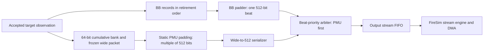

# BB and PMU packetization plan

Date: 2026-09-21\
Status: proposed bridge/host design; no packetizer RTL implemented.\
Related: [stream transport evidence](firesim-pmu-stream-transport.md),
[trace/interval contract](boom-pmu-sim-trace-plan.md),
[PMU API](boom-pmu-api.md), [counter catalog](boom-pmu-counter-catalog.md).

## Decisions and scope

- One BB record occupies exactly one 512-bit beat, including padding.
- One PMU record occupies a whole number of 512-bit beats. Pad only the final
  beat and emit one header for the entire record.
- PMU capture presents one complete wide packet of elaboration-fixed length.
  Static padding rounds it up to a multiple of 512 bits; a serial width adapter
  emits 512-bit slices. BB records bypass that adapter.
- An ordinary beat-priority arbiter gives PMU output priority over BB output.
  The PMU serializer continuously asserts valid until its final beat transfers,
  so no additional packet reservation is needed to prevent interleaving.
- Use uniform 64-bit cumulative counters in the bridge and calculate deltas in
  software. Native TilePMU and its MMIO API are unchanged. Narrow increment
  channels remain the input to the independent bridge bank.
- The prior range-sized saturating delta format is a deferred optimization,
  not the initial wire format or a prerequisite for transport.

The implementation is independent of TraceDoctor's producer, format, and workers.
Reuse FireSim's stream engine and platform DMA support.

## Record layout

The following exact field allocation is a proposed v1 format, not an existing
ABI. Values are unsigned, little-endian 64-bit words. Emit the header first;
the first word occupies bits [63:0] of the first beat. Zero all padding.

A proposed common 64-bit header contains:

| Bits | Field | Meaning |
| --- | --- | --- |
| 7:0 | record_type | BB, PMU, or ordered control record |
| 15:8 | format_version | Decode/layout version |
| 31:16 | flags | Type-specific partial/start/stop/boundary flags; reserve unused bits |
| 63:32 | payload_words | Number of 64-bit payload words, excluding header and padding |

Numeric type/flag assignments remain to be fixed when implementing the decoder.
Validate payload length against record type and manifest before allocation.
One stream initially belongs to one tile/source. An ordered epoch/configuration
record establishes source, catalog identity, and capture epoch before data.
This avoids assuming those identifiers also fit in every 64-bit header. A
future multiplexed-source stream needs an explicit format extension.

### BB: one record per beat

| Word | Field | Meaning |
| --- | --- | --- |
| 0 | header | BB type, flags, payload_words = 4 |
| 1 | start_pc | First included architecturally retired instruction |
| 2 | end_pc | Terminating instruction PC, or last included PC for a partial block |
| 3 | instruction_count | Retired instructions included in this BB record |
| 4 | elapsed_cycles | Target cycles since the previous BB boundary |
| 5-7 | zero padding | Ignored by decoder |

The payload is 256 bits, the header is 64 bits, and padding is 192 bits. Do not
pack several BBs into a beat in v1. Do not derive instruction count from PC
subtraction; mixed instruction lengths and dynamic execution make that unsuitable.

The producer reports instruction and elapsed-cycle deltas directly. Instruction
count ends at the relevant retirement slot, not the full superscalar group's
final count. Blocks are emitted in retirement order. Multiple BBs can finish in
one target cycle: the first receives elapsed cycles since the previous boundary
and later ones receive zero. This is boundary-to-boundary elapsed time, not
causal attribution of pipeline events to instructions.

A `terminate_interval` header bit marks the BB record that closes an interval,
after that record's instructions and cycles have been included. The bridge tracks
intervals; the host checks that each completed interval has exactly one complete
PMU snapshot. Queue snapshots in order because PMU priority can send snapshots
ahead of several closing BB records. Capture baselines and partial final intervals
are distinguished from ordinary completed intervals. The bit position remains
unspecified.

Capture start, stop, traps, and context changes delimit partial blocks through
flags/ordered control records. Their detailed producer semantics follow the
parent trace contract; the packet layer must not silently discard their retired
instructions or charge time across an unmarked epoch discontinuity.

### PMU: one header and as many beats as needed

Proposed payload:

| Word | Field | Meaning |
| --- | --- | --- |
| 0 | header | PMU type, flags, payload_words = 4 + counterCount |
| 1 | snapshot_id | Logical observation/interval association within the epoch |
| 2 | boundary_retired | Logical boundary position through the selected instruction |
| 3 | cycle_end | Physical target cycle included in the snapshot |
| 4 | retired_cycle_end | Retirement position after the entire physical cycle's group |
| 5 onward | counters | Uniform 64-bit cumulative values in manifest order |
| final unused words | zero padding | Reach the next 512-bit boundary |

Separate boundary_retired from retired_cycle_end because a logical interval can
end inside a superscalar group while PMU events describe the whole cycle.
The snapshot ID associates the counter observation with the logical interval;
its wire position relative to BB packets does not define that interval.

For N counters and four metadata words:

```text
recordWords = 1 + 4 + N
beatCount   = ceil(recordWords / 8)
padWords    = (8 - (recordWords % 8)) % 8
```

With the current 19-counter native catalog selected, this is 24 words, exactly
three beats. With 18 counters it is 23 words plus one padding word, also three
beats. Metadata therefore matters when estimating the packet size. No header or
chunk index is repeated on continuation beats.

All counter words come from one frozen vector. A record emitter must never read
live counters sequentially to construct a purported coherent snapshot.

## Bridge accumulation and capture

Counters advance exactly once per accepted target token and wrap modulo 2^64.
At a boundary, capture the counter value after adding that same token's event
increments. Do not clear cumulative counters at each boundary. They are
independent of native MMIO counter enable/clear/write controls.

Emit a baseline PMU snapshot at capture start and endpoint snapshots thereafter.
Software computes modular differences between adjacent observations within the
same epoch. Reset/rearm/configuration changes must be explicitly delimited;
never subtract across them. Exact delta reconstruction requires less than 2^64
events between adjacent snapshots; there is no special all-ones sentinel in v1.
No interval watchdog, heartbeat, saturation, or variable overflow packet is added
for this initial 64-bit format.

Several logical boundaries in one target cycle can share the same cumulative
counter vector and cycle timestamp, with distinct logical endpoint metadata.
Successive software deltas for identical vectors are zero, not duplicate full
interval counts. The existing within-cycle attribution limitation remains.

## Datapath



The counter catalog, header, and metadata widths are fixed for an elaboration.
Thus recordBits, paddedBits, and beatCount are compile-time parameters, not
runtime packet-assembly decisions. Capture the coherent counter vector and its
metadata together as one wide record. Padding is constant concatenation; no
narrow-word emitter or padding state machine is required.

The serializer retains the complete padded packet (or holds a frozen snapshot
source until consumed), selects the current 512-bit slice, and advances its beat
index only on output fire. For the proposed 19-counter format this is a 1536-bit
packet emitted in three transfers. It can offer one beat every FPGA cycle while
the output accepts data; the next slice is already present and never requires
waiting for eight input words to arrive.

The target supplies observations; packetization above lives in the FPGA bridge.
The complete wide packet is local to the bridge, not an export of native PMU
counter values through the DUT hierarchy. Storage and mux timing still need
measurement.

The existing TacitBridge SerialWidthAggregator accepts masked byte lanes and
assembles wide beats; its input interface is not the intended complete-packet
interface. The required operation here is wide-to-narrow serialization, regardless
of the eventual class name. A width-conversion FIFO or dedicated beat selector
can implement it, subject to width/depth restrictions of the reused component.

## Beat priority and serializer contract

Ordinary PMU beat priority is sufficient under the following invariant:

```text
Once a PMU packet is available, pmu_beat.valid stays asserted
until its final beat is accepted.
```

A complete retained packet makes that invariant straightforward. During output
backpressure, hold the current slice and index stable. With ready high, advance
to the next slice on each fire; valid remains high between slices. The arbiter
therefore always sees PMU available and cannot insert a BB between PMU beats.
The earlier concern about inter-beat refill gaps applied to an unnecessary
narrow-word assembly design, not this fixed wide packet.

Additional handshake rules:

- At selection, choose PMU whenever its beat is valid. After the final PMU beat
  transfers into the ordered stream FIFO, BB can follow immediately; there is
  no need to wait for host DMA consumption.
- Retain a selected stalled output beat until it transfers (for example with an
  output holding register). A newly arriving PMU cannot replace an already
  presented BB beat under this interface contract. This is single-beat stability,
  not a lock spanning the PMU packet.
- Make same-batch PMU and BB candidates eligible in aligned pipeline stages so
  the boundary BB is not released while its PMU packet is still being registered.
- Do not overwrite the frozen PMU packet before the final beat transfer.
- Serializer, arbiter output, and FIFO progress use FPGA-side handshakes, not
  target-token acceptance. Otherwise pausing target acceptance during packet
  draining would deadlock the batch scheduler.

If a future serializer inserts valid gaps, it must either preserve the invariant
using buffering or change the arbiter contract. Such a gapped producer is not
part of this design.

## Timing, ordering, and initial scheduling policy

Priority establishes transmission order, not measurement time. Correct timing
comes from atomic capture of increments, retirement prefixes, timestamps, and
boundary controls from the same accepted target token. Repeated FPGA cycles
spent serializing that token must not increment counters or timestamps again.

PMU priority means a snapshot can precede the BB that closes its interval. The
host must therefore associate by epoch/snapshot ID and boundary_retired rather
than interpreting PMU packet arrival as 'all preceding BBs complete this interval'.
Retain a pending snapshot until BB processing reaches the indicated endpoint.
If the same target cycle contains several BB completions and logical boundaries,
PMU records may precede all BB records of that cycle; retirement endpoint ordering
still determines the logical partition.

For v1, process one target-cycle output batch at a time:

- Accept a target token only when the bridge can retain every BB completion and
  boundary descriptor it may produce, together with the coherent snapshot data.
  Provision for the actual retirement width; do not silently support just one BB
  or boundary per cycle.
- Emit all pending PMU packets for that batch first, then its BB packets in
  retirement order. A single frozen physical vector can serve several boundary
  descriptors for that same target cycle.
- Accept the next target token after the current batch's output is enqueued into
  the common stream FIFO. Cycles without records need no serialization delay.

This conservative policy prevents older BB backlogs from being overtaken by an
unbounded sequence of future PMU packets. It also prevents PMU starvation of BB:
the current batch has a finite number of PMU descriptors, and future batches
cannot enter until its BBs have been serviced. Output backpressure can pause the
simulation, but it never inserts architectural retirement-stall cycles.

Epoch/configuration control records are scheduled at batch boundaries. Emit
configuration before its baseline PMU snapshot and drain the prior epoch's data
before publishing the next epoch. Stop is ordered after final PMU/partial-BB
output. A target reset cannot silently erase a partially transmitted record;
finish an already frozen record before an epoch-change marker where possible,
or explicitly terminate the stream as incomplete on a hard abort.

## Host decoder and accounting

At a packet boundary, validate the header and derive its padded beat count. BB
records require four payload words and one beat. PMU payload size must match the
selected manifest plus metadata. Continuation beats contain payload, not headers.
Retain partial PMU packets across DMA pulls. Ignore final padding and reject
truncation at end of stream. Padding must never be interpreted as a BB record.

Keep BB retirement order independently from PMU transmission priority. Join
snapshots and intervals using endpoint metadata; use software counter differences for RFV and the reported BB instruction/time
deltas for IPC and BBTV. Same-cycle BBs and duplicate physical
PMU endpoints follow the explicit zero-cycle attribution convention. Do not divide
by zero or replace actual interval lengths with the nominal instruction count.

No worker should finalize an interval solely on receipt of its PMU header or
packet. Wait for the complete counter packet and the BB endpoint it identifies.

## Implementation sequence and validation

1. Freeze header type/flag assignments and epoch/control payloads, retaining the
   layouts and counts above as the proposed baseline. Publish a versioned manifest.
2. Build a software packet codec/reference and test layout, lengths, little-endian
   words, padding, counter differencing, and PMU-before-BB association.
3. Implement BB padding, complete wide PMU capture/static padding, a continuously
   valid wide-to-512 serializer, and a PMU-priority arbiter with output buffering.
4. Integrate accepted-target-token accumulation and bounded batch capture.
5. Run metasim and then FPGA timing/throughput validation before adding overlap.

Meaningful cases include:

- BB record with exactly three zero padding words.
- PMU packet exactly aligned, partially padded, and longer than two beats;
  18-counter and 19-counter layouts with the proposed metadata.
- Assert continuous PMU valid from first availability through last transfer;
  with a ready BB and ready output, all PMU beats transfer consecutively.
- BB already valid but stalled when PMU becomes pending: no unstable output.
- Stalls on the first, middle, and final PMU beat: valid remains asserted,
  payload/index remain stable, and the snapshot remains retained until fire.
- Simultaneous BB/PMU generation, multiple BBs and boundaries in one target cycle,
  consecutive boundary cycles, and target cycles with no outputs.
- Baseline, counter wraparound, identical-cycle snapshots, partial stop, and epoch
  transitions; no subtraction across epochs or duplicate target updates.
- PMU packet split across DMA pulls and multiple packets in one pull.
- Host stalls change throughput but not decoded observations or target time.

The main costs are 64 bytes per BB, wide snapshot storage and slice selection,
and one successful stream transfer per PMU beat. Those are explicit first-version tradeoffs, not correctness
flaws. Reconsider denser BB packing or deeper pipelining only after measuring.
